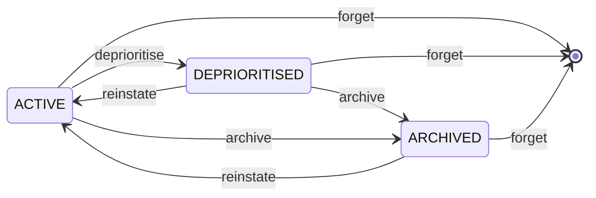

# Features in Depth

The bits that make OmniMem more than a key-value store with an MCP wrapper: a proper lifecycle, a graveyard of dead ends, experience scoring, deduplication, contradiction detection, a one-call briefing, cross-project recall and background maintenance. The [skill compiler](skill-compiler.md) gets a page of its own.

## Memory is not binary

Most systems either remember something or delete it. OmniMem has a lifecycle:



| State | Recall weight |
|---|---|
| `ACTIVE` | 1.0x |
| `DEPRIORITISED` | 0.2x (`DEPRIORITISED_WEIGHT`) |
| `ARCHIVED` | 0x |
| `DELETED` | gone |

When you say "forget about X" you rarely mean destroy it. You mean stop bringing it up. So OmniMem deprioritises rather than deletes, and if something becomes relevant again later it can earn its way back.

- **`deprioritise`** when something should stop surfacing but might matter again one day. Add `reinstate_hints` to say what should bring it back: when a later query contains one, the memory resurfaces as a reinstate candidate with a note explaining why it was pushed down.
- **`archive`** for things that are definitely out of date but worth keeping for history.
- **`forget`** only when you want it gone for good. It needs `confirm=True`, so nothing vanishes by accident.

Deprioritise a memory with an effort score of 4 or more and OmniMem will point that out first. It isn't blocking you, just checking you meant to bury something that was properly hard to figure out.

You can also suppress whole topics. `suppress_topic("pisource.org")` keeps anything mentioning it out of every recall, the briefing and the dead-end warnings, in every session, until you lift it. And `deprioritise_project` turns an entire project down in one go (reversibly, with `reinstate_project`).

The full storage model is in the [memory type specifications](memory-types.md).

## The graveyard

OmniMem tracks what didn't work as well as what did, and why.

Every abandoned approach is logged with its name, type and the reason it failed. Before your agent suggests a library or a pattern, the graveyard gets checked, and if you've tried it before and given up, the warning comes first, ahead of anything else in recall.

```
WARNING: previously abandoned approaches match this query

  onnxruntime       library     SIGILL crash on Alpine musl libc       effort: 4/5
  FLAT index        approach    too slow above 10k vectors              effort: 3/5
  openai embeddings service     API cost and latency were prohibitive   effort: 2/5
```

The fast path is a keyword scan of the graveyard, so it doesn't even wait for an embedding. Record dead ends with `record_experience` at the end of some work, or one at a time with `log_abandoned` as you go. Nothing is hidden as a result: abandoning an approach does not suppress anything, it means a later session that proposes the same approach is answered with what happened last time and what worked instead.

By default a recall scoped to a project, and the Claude Code hook working in one, are only warned about dead ends from that project (plus any recorded with no project at all), so one project's lesson doesn't block another's. A recall with no project filter still sees every dead end, and `warn_if_abandoned` always does, naming the project on each match. If you'd rather a dead end followed you everywhere, set `GRAVEYARD_SCOPE=all`: the warning then ends with "Recorded on project X" when it isn't from the project you're in. An archived memory's dead ends keep warning either way.

Dead ends don't get a second chance to waste your afternoon.

## Experience scoring

Not every success is equal. Something that worked first time is useful. Something that took four attempts, two abandoned libraries and a weird platform-specific workaround is gold, and it should surface more readily.

OmniMem gives every memory an experience weight from its effort and outcome:

| Effort | Meaning | Weight when it succeeded |
|---|---|---|
| 1 | Worked first time | 1.0x |
| 2 | Minor friction | 1.1x |
| 3 | Multiple iterations | 1.25x |
| 4 | Significant struggle | 1.5x |
| 5 | Battle-hardened | 1.8x |

A pivot starts from 0.7 and gets the same multiplier, so a hard-won pivot still counts. An abandoned outcome is a flat 1.0 however much effort went in: effort multiplies success, it never amplifies a failure. It used to be 0.1, which buried the write-up of the failure along with the approach, so the one memory that explained why something did not work ranked below almost everything else.

That weight goes straight into the ranking:

```
score = similarity x surface_score x recency x experience_weight x date_boost
```

A battle-hardened success is worth nearly twice as much as something trivial. Knowledge earns its rank. [Architecture](architecture.md#the-recall-pipeline) walks through the rest of the formula.

## Semantic deduplication

Memory systems pile up near-identical entries over time. OmniMem catches them in two places.

When you `remember()` something, it's compared with what's already stored, and above `DEDUP_SIMILARITY_THRESHOLD` (0.92) you get the existing memory back instead of a redundant copy. Pass `force=True` when you really do want both.

For a bulk tidy-up, `find_duplicates()` scans a namespace using the vectors already stored (no re-embedding) and returns clusters of near-duplicates. Point it at your episodic memories now and again and archive the extras, or use the Duplicates page in the [settings panel](settings-panel.md).

## Contradiction detection

The graveyard warns you about things that failed. Contradiction detection warns you about things that disagree with each other.

When `remember()` stores a memory it runs a quick heuristic: find similar memories and look for opposing language (one says "use X", the other says "avoid X"). If it finds a likely contradiction, it stores the memory anyway and hands back a warning so you can look into it.

For a closer look, `check_contradictions(use_api=True)` asks Claude to judge the candidate pairs. Confirmed contradictions are linked on both memories and flagged whenever either one comes up in recall. Without an API key you get the heuristic and nothing breaks.

```
contradiction_warning:
  existing_key: mem:episodic:01ARZ3NDEK...
  existing_content: "Always use connection pooling for the database..."
  explanation: "These memories discuss the same topic but contain opposing language"
```

### Settling a contradiction

A link that nothing can clear just nags, so a pair can be resolved: you say which memory is current, or that both stand, and the warning stops. The link isn't deleted (the scan would only find the pair again). It gains a `resolution` on both memories:

```json
{"key": "mem:episodic:01B...", "explanation": "...", "detected_at": "...",
 "resolution": {"outcome": "supersedes", "winner": "mem:episodic:01B...",
                "reason": "we moved to rebase", "resolved_at": "...",
                "resolved_by": "panel", "history": []}}
```

| Outcome | Meaning | The loser |
|---|---|---|
| `supersedes` | One is current, the other out of date ("we moved from X to Y") | Gets `superseded_by`; the winner gets `supersedes`. Optionally deprioritised or archived, and its extracted facts follow |
| `both_valid` | Not a contradiction: different contexts, projects or times | Nothing |
| `both_wrong` | Neither holds | Both optionally deprioritised or archived |
| `false_positive` | The heuristic misfired | Nothing; the pair is never flagged again |
| `reopened` | Circumstances changed: put the warning back | Nothing; the earlier resolution is kept in `history` |

A resolved pair drops out of the briefing, the session-start hook, the Contradictions page, `check_contradictions` and the maintenance scan. Recall still shows it: a hit carries `resolved_contradictions` (and `superseded_by` for a memory that was replaced), so an agent reads "superseded by X" rather than "disputed". `explain_memory` and the memory's page show the history. Forget one of the pair and the other's link is settled as `other_forgotten`.

Who decides is a person. From an agent it is `check_contradictions(mode="resolve", ...)`, and under `HUMAN_APPROVAL=human` (the default, the same switch as skill writes) OmniMem asks you through MCP elicitation, showing both memories, the outcome, the winner and the reason; nothing is written unless you accept. If your client can't be asked, the proposal waits a week as Pending on the Contradictions page (a newer proposal for the pair replaces it), or you can deal with it from a terminal, where `resolve` and `accept` ask you to type the last six characters of the first key, and refuse to run with no terminal at all, so a script an agent writes can't settle a pair for you. `HUMAN_APPROVAL=agent` lets the agent's call write straight away. The question is shown by your client, so what that guarantees (and doesn't) is the same as for skills: see [what the gate rests on](skill-compiler.md#what-the-gate-rests-on). On a server with no window:

```bash
omnimem contradictions                                   # open pairs and pending proposals
omnimem contradictions resolve KEY_A KEY_B --outcome supersedes --winner KEY_B \
    --reason "moved to rebase" --retire-loser
omnimem contradictions accept KEY_A KEY_B                # a pending proposal, as proposed
omnimem contradictions discard KEY_A KEY_B
```

## Trust

`state` says whether a memory is visible. Since 7.0.8, `trust` says whether OmniMem believes it.

| Trust | What it means | Recall | Briefing | Skill compiles |
|---|---|---|---|---|
| `accepted` | Believed. Anything you or an agent stored, and RSS articles | Ranked as normal | Shown | Used |
| `candidate` | A fact or preference OmniMem extracted for itself, which no one has confirmed yet | Ranked at `TRUST_CANDIDATE_WEIGHT` (0.9) | Left out | Left out |
| `disputed` | In an open contradiction the model confirmed | Ranked at `TRUST_DISPUTED_WEIGHT` (0.8) | Only as a contradiction warning | Left out |
| `superseded` | A resolution named another memory as current (`superseded_by`) | Folded into the winner's hit, under `replaces` | Left out | Left out |
| `rejected` | A person judged it wrong | Never returned | Left out | Left out |

Every recall hit carries its `trust`, so an agent can see why something ranked lower, and `recall_detail`, `explain_memory` and the memory's page in the settings panel show it for any key, including a rejected one.

**The weights only reorder.** They multiply the final score, as the recency decay does: a candidate counts about as much as if it were 90 days older. The relevance floor and the weak band read raw similarity, so a weight never drops a memory out of the results, it only changes the order and which memories make the `top_k` cut. A store where everything is accepted scores exactly as it did before.

**Who moves it.**

- Extracted facts and preferences start as `candidate`. Everything else starts `accepted`, including RSS articles: an article's summary stands in for its source, while an extracted fact sits beside a note you already have. `TRUST_ENRICHMENT=accepted` makes new extractions start `accepted` too: your standing decision that you trust the extraction, made once on the Configuration page rather than per fact. It doesn't change what's already stored.
- A contradiction the model confirmed (`check_contradictions(use_api=true)`) disputes both memories. One found only by the quick heuristic doesn't, since two memories sharing words and a "not" isn't evidence enough to rank either down. The heuristic link still warns as before.
- Resolving it moves them on. With `supersedes` the winner is `accepted` and the loser `superseded`. `both_valid` and `false_positive` send each back to what it was before. `both_wrong` rejects both, and `reopened` disputes them again. Forgetting one side ends the other's dispute, and forgetting a winner brings back what it had superseded.
- Only a person confirms a candidate or rejects a memory: on the **Unconfirmed** page of the settings panel (one at a time, or every candidate from one source memory at once), on a memory's own page (Confirm, Reject with a reason, Restore), or with `omnimem trust` from a terminal, which asks you to type the last six characters of the key and refuses to run without a terminal (since 7.0.12). No MCP tool can, so an agent can't promote its own conclusions, the same rule as the [skill gate](skill-compiler.md#who-accepts). Promoting knowledge to a skill domain doesn't confirm it either, since an agent can call that.
- Every change is in the [audit log](audit-log.md) at `lifecycle`, with who made it and why.

**Confirming in bulk.** `omnimem trust list --json` prints every candidate with the memory it came from, and `omnimem trust confirm-source <key>` confirms everything extracted from one memory, so a loop over the sources confirms the lot (the [README](../README.md#upgrading-to-708) has it as two lines). Each confirmation gets its own audit row. A confirmed fact can be put back with `omnimem trust reject` then `restore`.

Provenance still says who stated a memory and is never scored on. Trust says whether it's believed.

## When it was true

Since 7.0.11 a memory also says when it was true (`valid_from` and `valid_to`) and when OmniMem believed it (`created_at` and `retired_at`), so "where did Sam live last March" and "what did we think last March" are different questions with different answers. Recall takes `valid_at` and `known_at` to ask them, and a memory that has stopped being true ranks lower and says so. See [bi-temporal memory](bitemporal.md).

## Session briefing

Rather than three separate calls at the start of a session, one `briefing(project="myproject")` gives your agent everything it needs:

- **Project context:** current state, stack, goals and domains
- **Experience summary:** effort stats, the graveyard, breakthroughs
- **Stale memories:** active memories untouched for `STALE_MEMORY_DAYS` (30)
- **New knowledge:** RSS articles from the last 7 days
- **Contradiction warnings:** memories with contradictions nobody has resolved
- **Reinstate candidates:** deprioritised memories whose hints match current work
- **Suppressed topics:** what's being filtered out
- **Skill suggestions:** compiled skills relevant to the work, as a recommendation rather than an auto-load. On a greenfield project with no context yet they move to the top, because there the skill is the only thing carrying your conventions
- **Skill updates:** a line per skill whose source memories changed since it was compiled, louder when the change is riskier
- **Knowledge watch:** recent articles that look relevant to a skill, and any that seem to contradict one
- **Auto-proposed skills:** at most once every `SKILL_SCAN_INTERVAL_HOURS` (24), drafts for domains whose lessons recur strongly enough to earn a skill. Proposals only: a human still accepts every one

One call, one response, full context.

## Cross-project recall by work type

Memory scoped to one project answers "what did we decide here?". It doesn't answer "what have I learned the hard way about Python?", which is the question you actually have when a familiar-feeling problem turns up in a project you started last week.

Projects declare **work-type domains**, the kinds of work inside them:

```python
set_project_context(
    project_name="omnimem",
    description="Self-hosted semantic memory for AI agents",
    stack="Rust, SQLite, ONNX Runtime",
    goals="Ship 7.0",
    current_state="v7.0.x branch",
    domains=["rust", "sqlite", "desktop-apps"],
)

recall("sqlite locking under concurrent writes", domain_filter="rust")
```

That searches every project declaring `rust`, not just the one you're sitting in. `project_filter` and `domain_filter` intersect when you give both, and `list_projects(domain="rust")` shows which projects a domain covers.

Three things stop it becoming a tagging chore:

- **It shares the skill vocabulary.** Project domains and skill domains normalise through the same code, so `py` becomes `python` in both and the same name reaches `find_skills()`. Skills carry the lessons that cleared the reinforcement gate; the domain filter reaches the raw memories underneath, including the gotcha you hit twice that never became a rule.
- **Domains suggest themselves.** `compile_project_domains(name)` reads the project's stack and the tags that keep recurring in its memories, and proposes a list with the evidence for each. It proposes by default, writes only with `auto_save=True`, and never removes a domain you set by hand. Projects with no domains get them seeded from their stack at start-up, so the filter isn't empty on day one.
- **An unmatched domain says so.** Filter on a domain no project declares and the search runs unscoped, with a notice up front saying the filter wasn't applied. A global search dressed up as a targeted one would be worse than no filter.

Domains route, they don't label individual memories. A project is Rust *and* CSS *and* Docker at once, so stamping all of those onto every memory would surface a CSS gotcha in a Rust search. The domain narrows which projects are candidates, and the vector search still decides what's relevant inside them.

## Automatic maintenance

Left alone, any memory store gathers duplicates and contradictions. OmniMem tidies up after itself.

Every `AUTO_MAINTENANCE_INTERVAL` briefings per project (10), a maintenance pass runs:

1. **Dedup scan:** clusters of near-identical episodic memories, keeping the newest and archiving the rest
2. **Contradiction scan:** similar active memories checked for opposing language (similarity 0.5 or more, at most 10 results)
3. **Knowledge expiry:** RSS articles past their expiry (`MAX_KNOWLEDGE_AGE_DAYS` after ingest, 30) are archived. Knowledge you stored yourself, or promoted, is never touched

What it did shows up in the briefing under `auto_maintenance`. Set `AUTO_MAINTENANCE_INTERVAL=0` to switch it off; `find_duplicates()` and `check_contradictions()` still work by hand.

## Licence and provenance

Every memory records two things about where it came from, and neither ever changes its ranking:

- **Licence:** may it be redistributed? `own`, `open`, `restricted` or `unknown`, decided at ingest. Recall points out anything still `unknown` so you can classify it. See [RSS and knowledge](rss-knowledge.md#licence-and-redistribution-rights).
- **Provenance:** who's speaking? `asserted` (you said it), `concluded` (the system's own write-up) or `retrieved` (an article or document). So a later session can tell evidence from its own reasoning, instead of citing itself as corroboration.

## The audit log

OmniMem keeps a record of changes: who made each one (an agent, the settings panel, a hook, the maintenance pass), when, and what moved from what to what. `AUDIT_LOG` chooses how much, from nothing up to the full text of every edit. The default, `lifecycle`, records state changes and deletes with their reasons and never memory text. See [the audit log](audit-log.md).

## See also

- [The skill compiler](skill-compiler.md): distil experience into loadable `SKILL.md` documents
- [The audit log](audit-log.md): who changed what, and when
- [MCP tool reference](mcp-tools.md): every tool these features expose
- [Architecture](architecture.md): how the recall pipeline applies all of this
